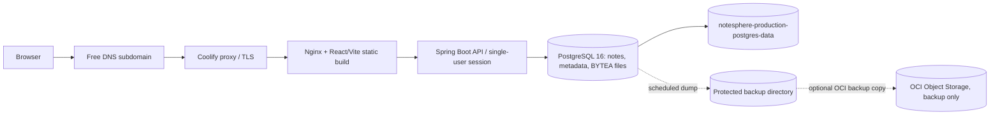

# Production deployment architecture

## Service topology

## Network boundaries

`compose.coolify.yaml` creates three paths:

| Network | Members | Purpose |
|---|---|---|
| `notesphere-production-data` (`internal: true`) | PostgreSQL, backend | Database access only; no host ports. |
| `notesphere-production-api` (`internal: true`) | Backend, frontend | Frontend Nginx can proxy to the API; frontend cannot resolve PostgreSQL directly. |
| Coolify's existing external `coolify` network | Frontend only | Reverse-proxy routing to container port 80. |

The production Compose file publishes no host ports. Coolify's reverse proxy handles browser ingress and TLS. Nginx serves the React build, forwards `/api/` to Spring Boot with proxy headers, and does not expose Actuator details.

## Persistence and application behavior

- Flyway adds the `attachments` table with PostgreSQL `BYTEA` file data and a `note_attachments` relation; existing note/folder migrations are unchanged.
- Attachment metadata queries omit `file_data`. Individual downloads read one bounded file at a time; upload size defaults to 25 MB.
- The backend protects API routes with a single configured Spring Security account, session cookie, and CSRF tokens. There is no per-user ownership or workspace separation.
- Note and folder ZIP exports include actual attachment bytes. Imports restore new rows and note links transactionally; note deletion/override removes unreferenced attachment bytes.
- PostgreSQL custom-format backups contain notes, metadata, and attachment content together. Optional OCI storage is only a destination for off-site database backups.
- `notesphere-production-postgres-data` is explicitly named and persistent. `notesphere-production-object-data` remains declared but unused by application services so legacy data is not removed during cutover.
- PostgreSQL, backend, and frontend have health checks and restart policies.

## Existing MinIO/RustFS cutover

The old MinIO/RustFS service must remain available until `scripts/migrate-minio-to-postgres.py` has copied and verified all objects. See [FILE_STORAGE_BACKUP.md](./FILE_STORAGE_BACKUP.md) for the non-destructive maintenance-window procedure. Keep the legacy volume until database restore and attachment round-trip checks succeed; the final application runtime does not connect to it.

## Public access and security boundary

The API is authenticated, but the shared login grants access to the entire single workspace. Configure a unique strong `APP_AUTH_PASSWORD`, require HTTPS for remote use, and keep PostgreSQL/backend off public networks. Add user/workspace ownership before enabling multiple accounts.

## Oracle cost model

The plausible Always Free host is one Ampere A1 VM at up to 2 OCPUs/12 GB RAM, using the home-region block-storage allowance (200 GB combined boot and block volumes). Oracle lists 10 TB/month outbound transfer and 20 GB combined Object Storage for an Always Free-only account. The separate 10-Mbps Always Free load balancer is not needed. Keep within limits, verify public IP and all resource charges in the tenancy, and do not enable paid resources. Free-tier capacity is not guaranteed and may be reclaimed when idle.

Reference: [Oracle Always Free resource limits](https://docs.oracle.com/en-us/iaas/Content/FreeTier/freetier_topic-Always_Free_Resources.htm), [Coolify Compose deployment](https://coolify.io/docs/applications/builds/docker-compose), and [Coolify health checks](https://coolify.io/docs/applications/configuration/health-checks).
