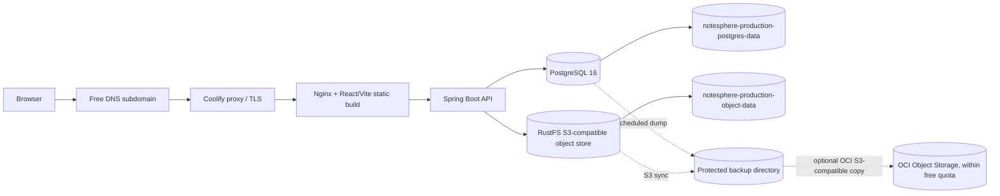

# Production deployment architecture

## Service topology

## Network boundaries

`compose.coolify.yaml` creates three paths:

| Network | Members | Purpose |
|---|---|---|
| `notesphere-production-data` (`internal: true`) | PostgreSQL, RustFS, bucket initializer, backend | Data and storage access only; no host ports. |
| `notesphere-production-api` (`internal: true`) | Backend, frontend | Frontend's Nginx can proxy to the API; frontend cannot resolve PostgreSQL or RustFS directly. |
| Coolify's existing external `coolify` network | Frontend only | Reverse-proxy routing to container port 80. Configure the domain in Coolify UI after the access-control gate. |

The production Compose file publishes no host ports. Coolify's reverse proxy handles browser ingress and TLS. Nginx serves the React build, forwards `/api/` to Spring Boot with the proxy's forwarded host/protocol headers, and does not expose Actuator details. PostgreSQL and RustFS console/S3 ports remain internal.

## Persistence and application behavior

- Database uses the repository's existing two Flyway migrations and validates the schema at runtime; no SQL migration is introduced.
- Attachments continue to use RustFS via the existing MinIO Java SDK. The RustFS `/data` directory is a named volume.
- `notesphere-production-postgres-data` and `notesphere-production-object-data` are explicitly named persistent Docker volumes.
- Note/folder ZIP archives and attachment URLs continue to use existing APIs and storage.
- PostgreSQL backup/restore uses custom-format dumps. Storage backup copies objects over S3 API. Restore scripts target a new database or empty bucket and do not delete existing data.
- PostgreSQL, backend, and frontend have Docker health checks and restart policies. The one-shot storage initializer waits for the RustFS S3 API and confirms the bucket before the backend starts; RustFS itself has no Docker healthcheck in this Compose definition.

## Public access and security boundary

The app has no authentication, authorization, or tenant isolation today. Therefore this design is private by default and the Compose file alone does not publish an application domain. Adding a domain in Coolify makes the entire unauthenticated API publicly reachable unless an access-control layer has been added and tested. Keep data services private regardless.

## Oracle cost model

The plausible Always Free host is one Ampere A1 VM at up to 2 OCPUs/12 GB RAM, using the home-region block-storage allowance (200 GB combined boot and block volumes). Oracle lists 10 TB/month outbound transfer and 20 GB combined Object Storage for an Always Free-only account. The separate 10-Mbps Always Free load balancer is not needed. Keep within limits, verify public IP and all resource charges in the tenancy, and do not enable paid resources. Free-tier capacity is not guaranteed and may be reclaimed when idle.

Reference: [Oracle Always Free resource limits](https://docs.oracle.com/en-us/iaas/Content/FreeTier/freetier_topic-Always_Free_Resources.htm), [Coolify Compose deployment](https://coolify.io/docs/applications/builds/docker-compose), and [Coolify health checks](https://coolify.io/docs/applications/configuration/health-checks).
